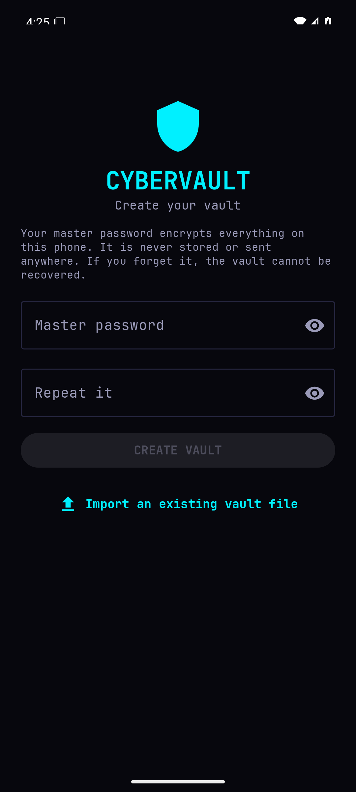
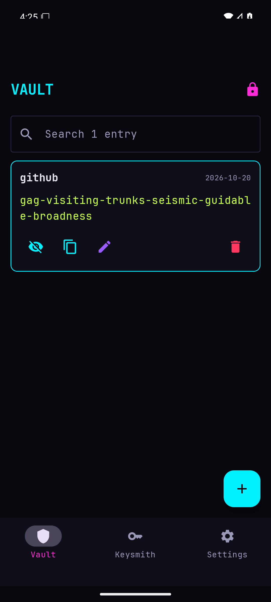
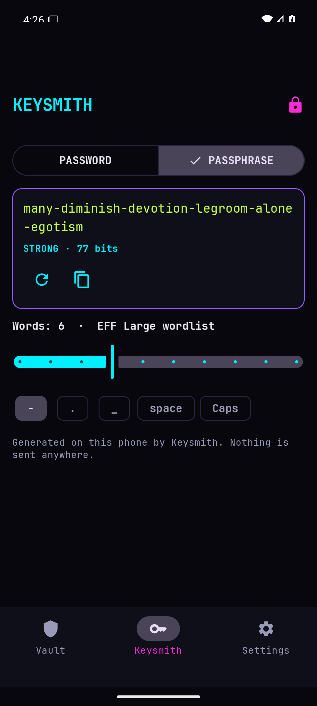
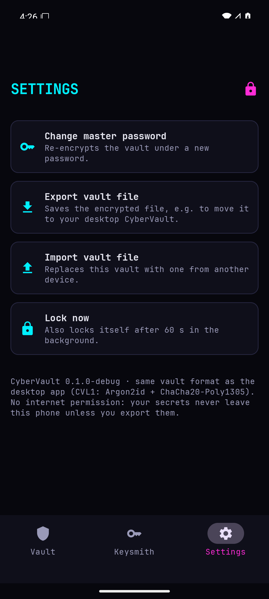
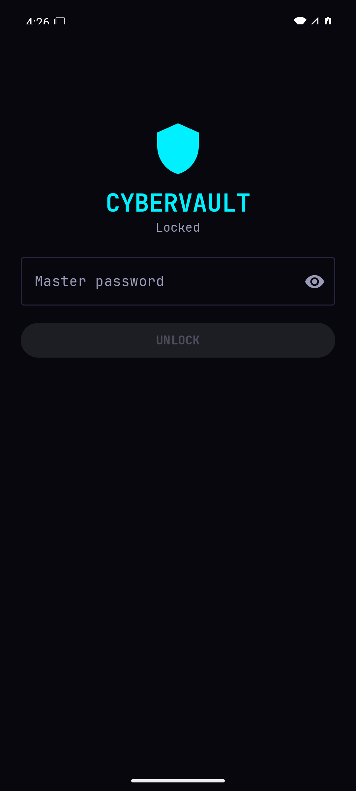

# 🔐 CyberVault for Android

**Your vault, in your pocket. Offline by design.**

An offline password vault for Android 11+, with [Keysmith](https://github.com/cybercoretech/keysmith) built in to generate strong passwords and passphrases. It uses **the same encrypted vault format as the desktop [CyberVault](https://github.com/cybercoretech/cybervault)**, from the same Rust code, so a vault file opens on either side.

🌐 **Site:** <https://cybercoretech.github.io/cybervault-android-app/> · 📦 **Releases:** [latest](https://github.com/cybercoretech/cybervault-android-app/releases/latest) · 🪪 **License:** MIT

<p align="center">
  
  
  
  
  
</p>

## ⚡ Install

From a Linux/macOS computer with `adb`, phone on USB with USB debugging on:

```sh
curl -fsSL https://cybercoretech.github.io/cybervault-android-app/install.sh | sh
```

The script downloads the latest release and checks its **SHA-256** and, when `apksigner` is available, its **signing certificate**. It only installs if both match. With more than one device connected it refuses to guess; set `ANDROID_SERIAL`. `CYBERVAULT_VERSION=v0.1.0` pins a release.

**Other ways in:**
- **Obtainium** (auto-updates): add `https://github.com/cybercoretech/cybervault-android-app`.
- **Manual:** download `cybervault.apk` from the latest release on the phone and open it. Verify it with `sha256sum --check cybervault.apk.sha256`.
- **F-Droid:** the Cybercore F-Droid repo is coming.

🪪 **Release signing certificate (SHA-256):**
`9dfa3699b793ad16af999b2fbe99b4b13ee26f8014705cc661521ee2b15e52cb`

## 🗝️ What it does

| | |
|---|---|
| 🛡️ **Vault** | Logins and other secrets: a label, the secret, an optional note (username, URL…). Search, reveal, copy, edit, delete. |
| ⚒️ **Keysmith** | Random passwords (8–64 chars, choose the character sets, drop look-alikes) or EFF Large diceware passphrases (3–12 words, separator, caps), with a live entropy meter. Generate inside the add/edit form and tap **USE THIS**, or use the standalone Keysmith tab. |
| 🔁 **Desktop round trip** | **Export** writes the encrypted vault file wherever you pick (it stays encrypted). **Import** checks the file's master password before replacing anything. Move vaults between the phone and `cybervault` on your computer. |
| 🔑 **Master password** | At least 10 characters; change it any time (it re-encrypts the vault). No recovery if forgotten, by design. |

## 🧱 Security model

| | |
|---|---|
| 📵 **No network** | The APK requests **no INTERNET permission**. CI fails the build if it ever does. |
| 🧬 **Crypto** | **Argon2id** derives a 256-bit key from the master password and a fresh 16-byte salt, and **ChaCha20-Poly1305** seals the JSON entries with a fresh 12-byte nonce. Format `CVL1`: `magic(4) · salt(16) · nonce(12) · ciphertext+tag`. |
| 🦀 **One implementation** | The vault code is the `cybervault` crate and the generators are the `keysmith` crate, linked through a small [uniffi](https://mozilla.github.io/uniffi-rs/) bridge (`rust/`). There's no crypto in Kotlin. |
| 💾 **Safe saves** | Every change is saved immediately through a temp file plus atomic rename. The vault lives in app-private storage (dir `0700`, file `0600`); Android backup and device transfer are disabled. |
| 🙈 **Screen** | `FLAG_SECURE` blocks screenshots, screen recording and the recents thumbnail in release builds. |
| 📋 **Clipboard** | Copied secrets are flagged sensitive and cleared after 30 s, or on lock. Only CyberVault's own clip is ever wiped. |
| ⏱️ **Auto-lock** | Locks after 60 s in the background, or with the 🔒 button. Locking drops the decrypted entries and the password, which the Rust side zeroizes. |

Read [`SECURITY.md`](SECURITY.md) and [`docs/THREAT_MODEL.md`](docs/THREAT_MODEL.md) for what this does **not** protect against.

## 🛠️ Building

Needs JDK 21, the Android SDK (platform 36, build-tools 36.0.0, NDK `27.2.12479018`), Rust with the `aarch64-linux-android` and `x86_64-linux-android` targets, and `cargo-ndk`.

```sh
./gradlew assembleDebug testDebugUnitTest lint assembleRelease
```

Gradle runs `cargo ndk` for both ABIs and generates the Kotlin bindings from an unstripped host build (`rust/uniffi.toml` turns on uniffi's Android cleaner, since `java.lang.ref.Cleaner` needs API 33). Rust-side checks:

```sh
cd rust && cargo fmt --check && cargo clippy --all-targets -- -D warnings && cargo test
```

**Release signing** uses `CYBERVAULT_RELEASE_STORE_FILE`, `_STORE_PASSWORD`, `_KEY_ALIAS` and `_KEY_PASSWORD`. Locally they're in `~/Vaults/android/cybervault-release.env`; in CI they're repository secrets. Pushing a `vX.Y.Z` tag builds, signs and publishes the release (`versionCode = X·10⁶ + Y·10³ + Z`).

## 🧪 Testing

- **Rust bridge:** 9 tests, including one that proves the desktop `cybervault` code reads what the bridge writes, plus wrong-password, duplicate-label, atomic-import and generator rules.
- **Kotlin unit tests:** search filtering, strength bands, entropy estimate.
- **End to end on an emulator:** `python3 tools/emulator_smoke.py`. It creates a vault, adds a Keysmith-generated entry, reveals it, locks, checks a wrong password is refused, unlocks, then pulls the vault file and opens it with the desktop CyberVault code (`rust/examples/inspect.rs`). `CV_RELEASE=1` runs the same flow on the signed, R8-minified release. The script only ever talks to `emulator-5554`.

## 🗺️ Roadmap

- **0.2:** Android Autofill service; biometric quick-unlock on top of the master password.
- **Later:** sync through Holodrive; listing on the Cybercore F-Droid repo, then the main F-Droid catalog with reproducible builds.

## 🔗 Related

- [CyberVault](https://github.com/cybercoretech/cybervault): the desktop TUI/CLI and the vault format.
- [Keysmith](https://github.com/cybercoretech/keysmith): the generator library and CLI.
- [CyberAuth](https://github.com/cybercoretech/CyberAuth): Cybercore's separate 2FA (TOTP) app. Keep second factors out of the password vault.

Fonts: JetBrains Mono, [OFL](docs/JetBrainsMono-OFL.txt).
